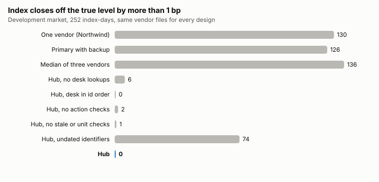
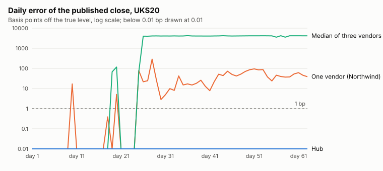
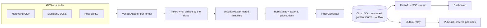
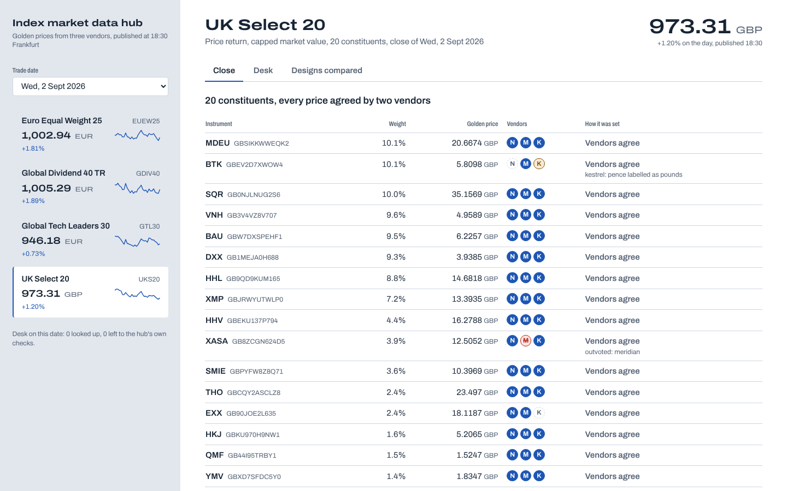
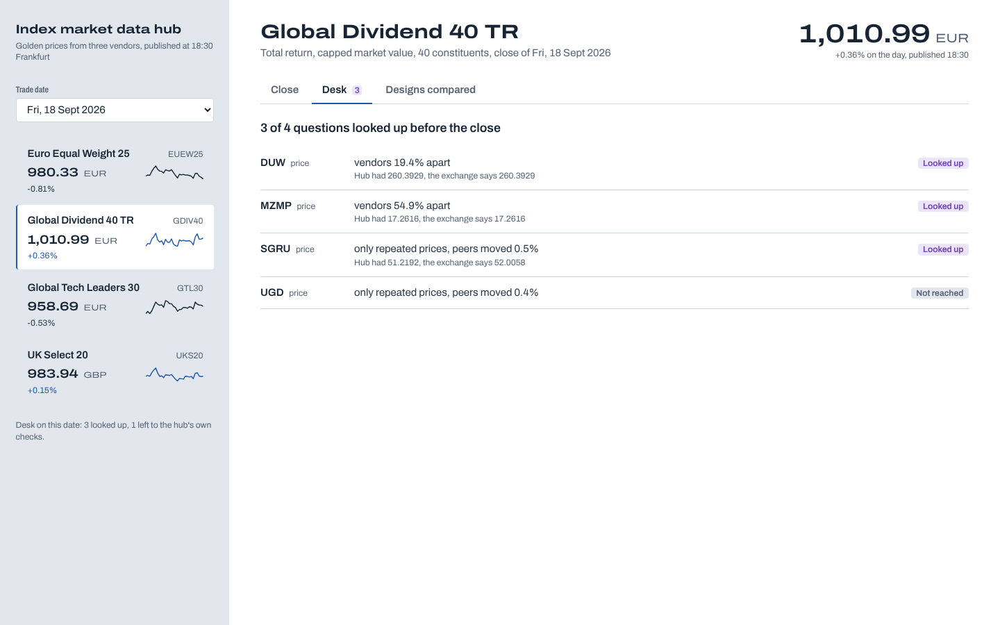

# index-market-data-hub

**Golden prices and index closes from three market-data vendors that are each wrong in their own way.**
Every evening an index calculation agent turns vendor quotes into closing prices, applies the day's splits and
dividends, and publishes index levels that ETFs and structured products track. A stale price, a pence/pound mix-up,
a reused ticker or a split applied a day late moves the published level, and a wrong close has to be corrected in
public. This hub lands three vendors' files, decides one golden price per instrument by agreement and checks, sends
the few real doubts to an operator desk ranked by index weight, calculates the indices, publishes at 18:30
Frankfurt time, restates the next morning when late files arrive, and keeps every version it ever published.

Built in Python for a market-data team on Google Cloud: FastAPI, SQLAlchemy on PostgreSQL, Pub/Sub, Cloud Run,
Cloud Scheduler, Cloud SQL and GCS, Terraform, Docker, GitHub Actions, and a React dashboard.

## Results

Everything below is measured on a simulated market whose true closes, corporate actions and renames only the
evaluation can see ([ADR 1](docs/adr/0001-simulated-market-with-hidden-truth.md)). Every design reads the same
vendor files. The development market was used to build and tune the hub; the held-out market was run once at the
end ([docs/heldout.md](docs/heldout.md)).

<!-- results:start -->

**Development market** (seed 20261119, 2026-07-01 to 2026-09-25): 63 business days, 160 instruments, 4 indices with 86 constituents, 30,794 vendor quotes, 6 vendor-days delivered after the close, 63 corporate actions and 4 renames on constituents (3 tickers reused).

| | One vendor | Median of three | **Hub** |
|---|---:|---:|---:|
| Index closes off the true level by more than 1 bp (of 252) | 130 | 136 | **0** |
| Worst index error | 288.7 bp | 4,233.9 bp | **0.0 bp** |
| Corporate actions missed or misapplied (of 63) | 7 | 4 | **1** |
| Desk lookups over the quarter | 0 | 0 | **13** (52 min) |





<details><summary>Every design on the development market</summary>

| Design | Index closes wrong or not calculable | Still wrong after next-morning restatement | Worst index error | Wrong golden prices | Wrong corporate actions | Desk lookups |
|---|---:|---:|---:|---:|---:|---:|
| One vendor (Northwind) | 130 | 130 | 288.7 bp | 81 | 7 | 0 |
| Primary with backup | 126 | 126 | 4,375.1 bp | 69 | 7 | 0 |
| Median of three vendors | 136 | 130 | 4,233.9 bp | 54 | 4 | 0 |
| Hub, no desk lookups | 6 | 5 | 21.6 bp | 2 | 2 | 0 |
| Hub, desk in id order | 0 | 0 | 0.0 bp | 0 | 1 | 145 |
| Hub, no action checks | 2 | 2 | 521.3 bp | 0 | 2 | 12 |
| Hub, no stale or unit checks | 1 | 1 | 1.5 bp | 1 | 1 | 15 |
| Hub, undated identifiers | 74 | 74 | 4,233.9 bp | 36 | 1 | 15 |
| **Hub** | **0** | **0** | **0.0 bp** | **0** | **1** | **13** |

| Why a golden price was wrong | One vendor (Northwind) | Median of three vendors | Hub, no desk lookups | Hub |
|---|---:|---:|---:|---:|
| vendor file after the close | 9 | 16 | 1 | 0 |
| quote missing | 14 | 5 | 0 | 0 |
| repeated price | 17 | 0 | 0 | 0 |
| bad tick | 9 | 0 | 0 | 0 |
| pence labelled as pounds | 1 | 1 | 0 | 0 |
| rename or reused ticker | 31 | 32 | 1 | 0 |
| other | 0 | 0 | 0 | 0 |

| Corporate actions on constituents | One vendor (Northwind) | Median of three vendors | Hub, no action checks | Hub |
|---|---:|---:|---:|---:|
| missed | 2 | 2 | 0 | 0 |
| applied on the wrong day | 2 | 0 | 1 | 0 |
| wrong ratio or amount | 3 | 2 | 1 | 1 |
| applied but never happened | 0 | 0 | 0 | 0 |

</details>

Gate on the development market: **passed** (wrong index closes 0 of at most 6, max index error bps 0.0 of at most 25.0, wrong actions 1 of at most 2, desk lookups busiest day 3 of at most 12). The product calculator and the world's own engine agree to 2.3e-15 on the true market.

**Held-out market, first and only run** (seed 50331, 2026-04-01 to 2026-06-26, 180 instruments, 13 late vendor-days, 58 corporate actions, 8 renames, 4 reused tickers):

| Design | Index closes wrong or not calculable | Still wrong after next-morning restatement | Worst index error | Wrong golden prices | Wrong corporate actions | Desk lookups |
|---|---:|---:|---:|---:|---:|---:|
| One vendor (Northwind) | 160 (124 not calculable) | 160 | 293.3 bp | 145 | 11 | 0 |
| Primary with backup | 120 | 120 | 534.4 bp | 129 | 11 | 0 |
| Median of three vendors | 70 | 68 | 70,884.2 bp | 28 | 4 | 0 |
| Hub, no desk lookups | 31 | 29 | 68.8 bp | 2 | 2 | 0 |
| Hub, desk in id order | 2 | 0 | 68.8 bp | 1 | 0 | 214 |
| Hub, no action checks | 46 | 46 | 506.6 bp | 0 | 2 | 9 |
| Hub, no stale or unit checks | 1 | 1 | 1.4 bp | 1 | 0 | 28 |
| Hub, undated identifiers | 2 | 4 | 265.6 bp | 1 | 0 | 12 |
| **Hub** | **0** | **0** | **0.0 bp** | **0** | **0** | **12** |

Hub gate on the held-out market: **passed**. What it got wrong is written up in [docs/heldout.md](docs/heldout.md).

<!-- results:end -->

## What happens at 18:30

1. **Land.** Each vendor file is parsed by its adapter (semicolon CSV with decimal commas keyed by ISIN, JSON lines
   keyed by RIC with London in pence, pipe-delimited integers keyed by ticker and MIC). A file that does not parse is
   quarantined whole; a file delivered twice is landed once. Only files delivered before the close count.
2. **Map.** A quote reaches an instrument only through an identifier valid on its trade date. A RIC rename also
   moves the ticker, so a newcomer that reuses an old ticker is never priced as the renamed company
   ([ADR 3](docs/adr/0003-dated-identifiers.md)).
3. **Corporate actions.** Applied when two vendors agree, or when one vendor's split ratio is confirmed by the price;
   disputed or unconfirmed ones, and a price jump that looks like an unannounced split, go to the desk.
4. **Golden price.** Pence labelled as pounds repaired, repeated prices dropped while peers moved, then the median of
   the largest agreeing group. One vendor alone may not move a price more than 6% from the peer-expected level: the
   last valid price is held until the desk confirms ([ADR 2](docs/adr/0002-agreement-checks-then-a-ranked-desk.md)).
5. **Desk.** At most 12 lookups before the close, riskiest first (index weight times doubt).
6. **Calculate and publish.** Divisor method, capped market value or equal weight, price or total return, FX at the
   fixing. Levels and golden prices are written with their publication time and an outbox event in one transaction.
7. **Next morning.** Late files are read again; a changed price restates yesterday as version 2 and an
   `index.corrected` event follows the original on the same Pub/Sub ordering key
   ([ADR 4](docs/adr/0004-bitemporal-golden-source-and-outbox.md)).

## The designs compared

| Design | What it does |
|---|---|
| One vendor | Northwind only: its prices, its corporate-action notices, its renames; a missing quote carries yesterday's price |
| Primary with backup | Northwind, and Meridian's price when Northwind has none |
| Median of three | the median of every quote; an action when two vendors announce it for the day |
| Hub, and five ablations | the full hub; without the desk; with the desk in instrument order; without action checks; without stale and unit checks; with an undated identifier map |

## Code



- **One contract for every vendor.** `VendorAdapter` is a template: subclasses only split rows and read one row;
  the same contract tests run against every subclass, so a new vendor cannot change what the pipeline receives.
- **Corporate actions answer for themselves.** The calculator calls `quantity_factor`, `restate_previous` and `cash`
  on whatever action it holds; a split, a dividend and a special dividend each implement them.
- **Designs are strategies** with `propose` (no side effects) and `commit`, so the same day can be proposed at the
  close and again the next morning.
- **Two engines for one methodology.** The world's array calculation and the product's divisor calculator share no
  code and agree to 1e-9 on the true market.
- **Twelve-factor service.** One image, settings only from the environment, logs to stdout; the API and the
  end-of-day job are two entrypoints ([docs/gcp.md](docs/gcp.md), [ADR 5](docs/adr/0005-gcp-stateless-eod-job.md)).

## Dashboard



Each constituent shows where its golden price came from: a filled mark for a vendor whose quote was used, an amber
ring for a repaired unit, a struck mark for an outvoted quote and a dashed one for a vendor that sent nothing in time.
The Desk tab lists the day's questions and what the exchange said; Designs compared shows the tables above.



## Run it

```bash
pip install -r requirements-dev.txt
python -m pytest                                  # 22-day market, every design, store, API, EOD job: ~5 s
python -m imdh.eval.cli evaluate                  # development market, all designs -> reports/dev.json
python -m imdh.eval.load                          # a quarter run by the hub into imdh.db
cd web && pnpm install && pnpm build && cd ..
python -m imdh.service                            # API and dashboard on http://localhost:8080
python -m imdh.eval.export --out drops            # the same quarter as vendor drops
IMDH_DROPS=drops IMDH_NOW=2026-09-25T19:00 python -m imdh.service.eod
```

`AGENTS.md` has the layout, the invariants and the held-out rule; `SKILLS.md` the repeatable tasks (add a vendor,
add a corporate-action type, tune a setting, deploy).

## Limits

- The market, the vendors and their faults are simulated. Fault kinds and rates are mine, not measured from real
  vendors; a non-faulty quote is exact, which makes agreement easier than with real vendors' closing rules.
- The desk always answers correctly; a real desk is slower and can be wrong.
- Index membership is fixed for the quarter (no additions, deletions or selection days); FX fixings are clean;
  dividends are gross, without withholding tax; there are no spin-offs, rights issues or mergers.
- The Terraform has been checked with `fmt` and `validate` in CI, never applied to a real project.
